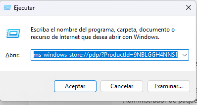
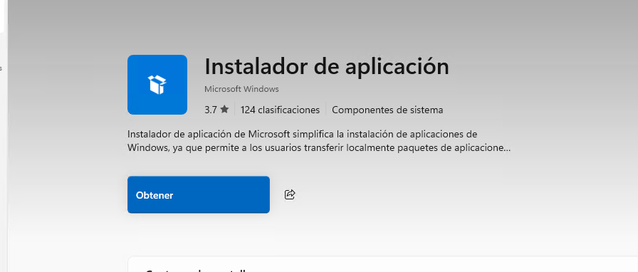
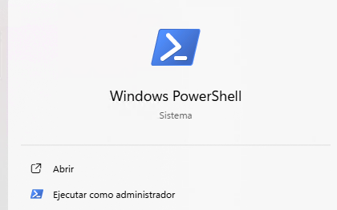
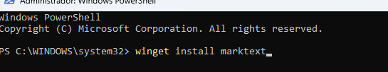
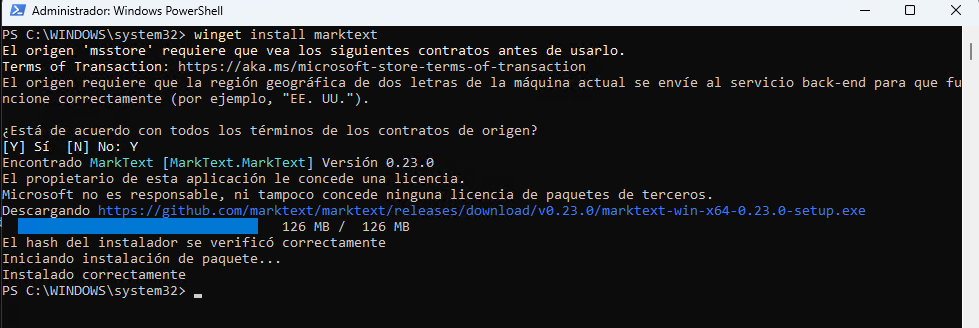
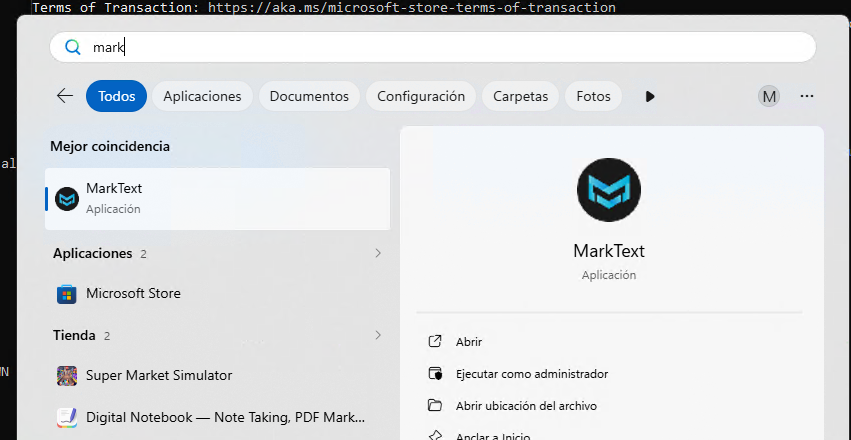

### Instalar winget

Hay dos opciones

#### desde la powershell

Desde la powershell como admin

```powershell
Add-AppxPackage -RegisterByFamilyName -MainPackage Microsoft.DesktopAppInstaller_8wekyb3d8bbwe
```

#### En la tienda de windows

ya sea bucandolo o ejecutando
[windows] + R 
y escribiendo lo siguente

```txt
ms-windows-store://pdp/?ProductId=9NBLGGH4NNS1
```



Es esta app



### Iusar winget para instalar una app

para este ejemplo marktext

Ejecutar powershell como admin





pregunta



Ya lo tenemos


